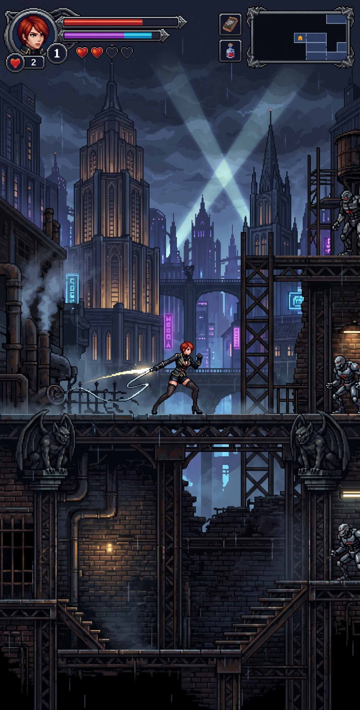

# Noite de Ferro

> Metroidvania 2D gótico-industrial: uma caçadora de chicote atravessa passarelas de ferro, telhados e porões de uma cidade sob chuva eterna.



**[▶ Jogar no navegador](https://elisio.github.io/metroidvania-prototype/)**

Feito em HTML5 Canvas + JavaScript puro: sem build, sem dependências, sem framework.

## Screenshots

As capturas do jogo ficam em [`docs/screenshots/`](docs/screenshots/). Exemplos (adicione os arquivos à pasta):

| Exploração | Mapa | Combate |
|---|---|---|
|  |  |  |

## Controles

| Ação | Teclado | Gamepad (layout padrão) |
|---|---|---|
| Mover | Setas / WASD | D-pad / analógico esquerdo |
| Pular | Espaço / Z | A (Cruz) |
| Chicote | X / J | X (Quadrado) / LT |
| Dash | C / K / Shift | B (Círculo) / RB / RT |
| Interagir | ↑ | D-pad ↑ / analógico para cima |
| Poção | Q | LB / L1 |
| Mapa | M / Tab | Select / Back |
| Pausa | Esc | Start |

**Toque na tela:** em celulares e tablets aparecem controles virtuais (direcional à esquerda, botões de ação à direita).

## Como rodar localmente

O jogo é um site estático. Duas opções:

1. **Abrir direto:** dê dois cliques em `index.html` (os scripts são carregados como `<script>` clássicos, então funciona via `file://`).
2. **Servidor local** (recomendado, comportamento igual ao do GitHub Pages):

   ```bash
   python3 -m http.server 8000
   # abra http://localhost:8000/
   ```

## Estrutura de pastas

```
index.html              ponto de entrada do jogo
src/                    motor e jogo (JS puro)
  config.js             constantes globais e "game feel"
  core/                 loop, tela, câmera, entrada, carregamento de assets
  world/  data/         mundo, salas e dados do mapa
  entities/ systems/    personagem e sistemas de jogo
  ui/                   HUD, menus, mapa
  audio/                som e música
assets/
  src/reference.jpg     arte de referência — fonte única de toda a arte
  game/                 arte do jogo gerada (PNGs + manifest.js + hero_sheet.js)
tools/                  scripts Python que geram os assets, smoke test e CI
  ci/                   check_syntax.sh e check_manifest.js (usados pelo CI)
docs/                   design, contrato de assets, contribuição, screenshots
.github/workflows/      CI e publicação no GitHub Pages
```

## Regenerar os assets

Toda a arte em `assets/game/` é derivada de `assets/src/reference.jpg` por scripts Python
(veja [`assets/game/README.md`](assets/game/README.md) e [`docs/ASSET_CONTRACT.md`](docs/ASSET_CONTRACT.md)):

```bash
python3 tools/build_assets.py --clean   # --clean refaz o cache de inpainting em tools/.cache/
```

## Testes e CI

```bash
bash tools/ci/check_syntax.sh        # node --check em src/ e assets/game/*.js
node tools/ci/check_manifest.js      # todo arquivo do manifesto existe
python3 tools/smoke_test.py          # smoke test no navegador (Playwright), com o servidor local rodando
```

O workflow [`ci.yml`](.github/workflows/ci.yml) roda tudo isso em cada push e pull request; o
[`pages.yml`](.github/workflows/pages.yml) publica o jogo a cada push na `main`.
Se a primeira publicação falhar por permissão, habilite em **Settings → Pages → Source: GitHub Actions**.

Veja também [`docs/CONTRIBUTING.md`](docs/CONTRIBUTING.md).

## Equipe

O protótipo foi produzido por uma equipe de agentes de IA, cada um com um papel:

| Papel | Responsabilidade |
|---|---|
| Direção de arte | arte de referência, paleta e contrato de assets |
| Arte técnica | extração, inpainting e montagem dos assets a partir da referência |
| Programação | motor, física, personagem, mundo e HUD |
| Revisão de arte | conferência visual dos assets e correções |
| QA | smoke test, capturas e relatórios de bugs |
| Som | efeitos sonoros e música |
| Publicação | CI, GitHub Pages e documentação |

## Status do protótipo

Protótipo jogável de **movimento e exploração**: corrida, pulo, chicote, dash, salas conectadas,
mapa e HUD. **Ainda não há inimigos nesta versão.**

## Roadmap

- [ ] Inimigos (robôs e criaturas da cidade)
- [ ] Chefes
- [ ] Mais salas e áreas, com habilidades que abrem novos caminhos

## Licença

Ainda não há licença definida pelo autor. Até que uma seja escolhida, todos os direitos são reservados.
